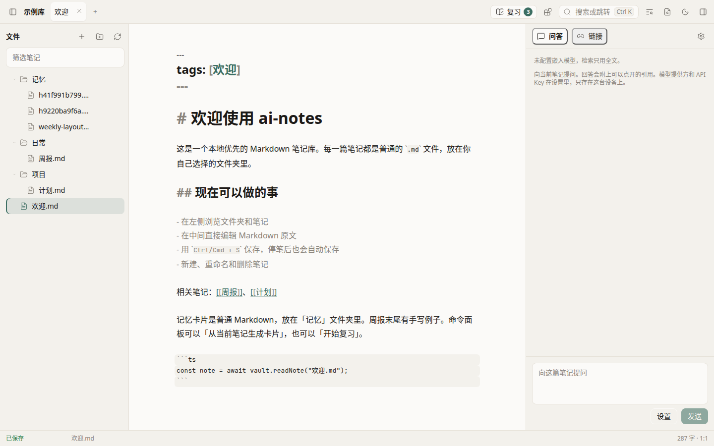
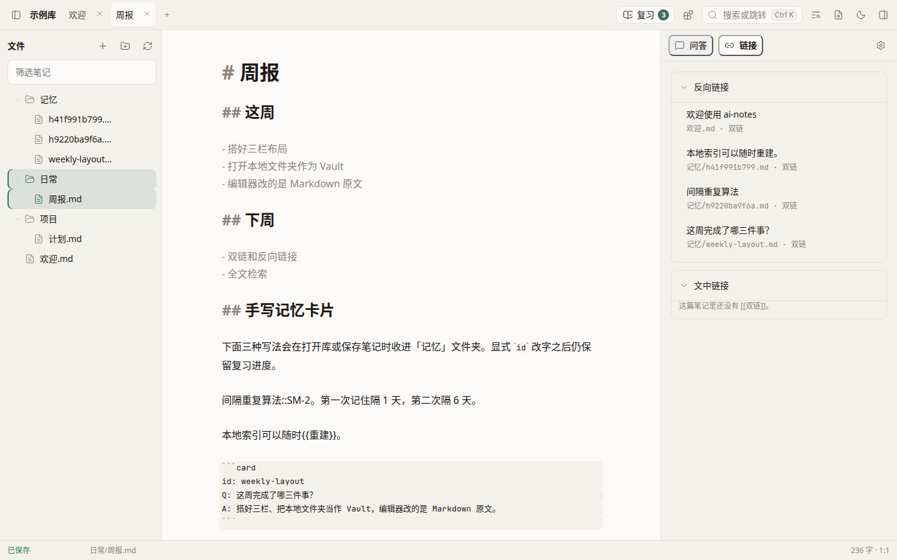
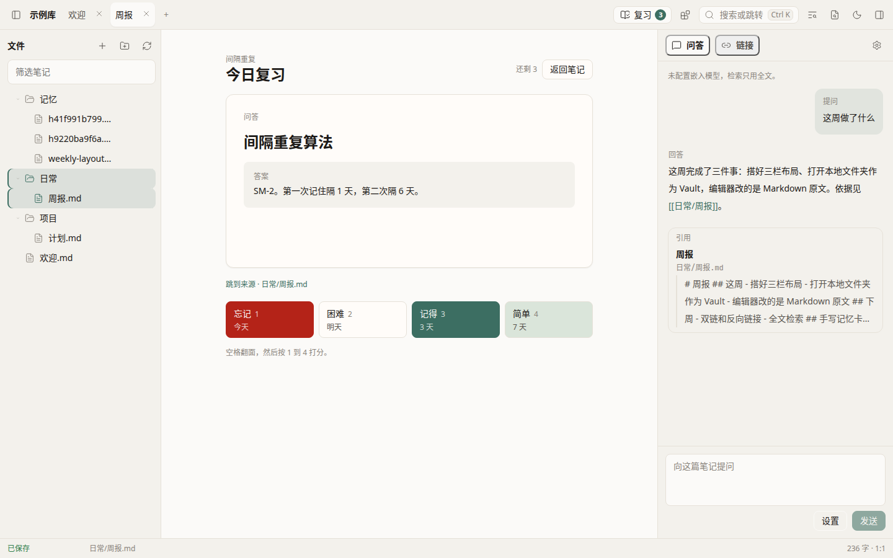
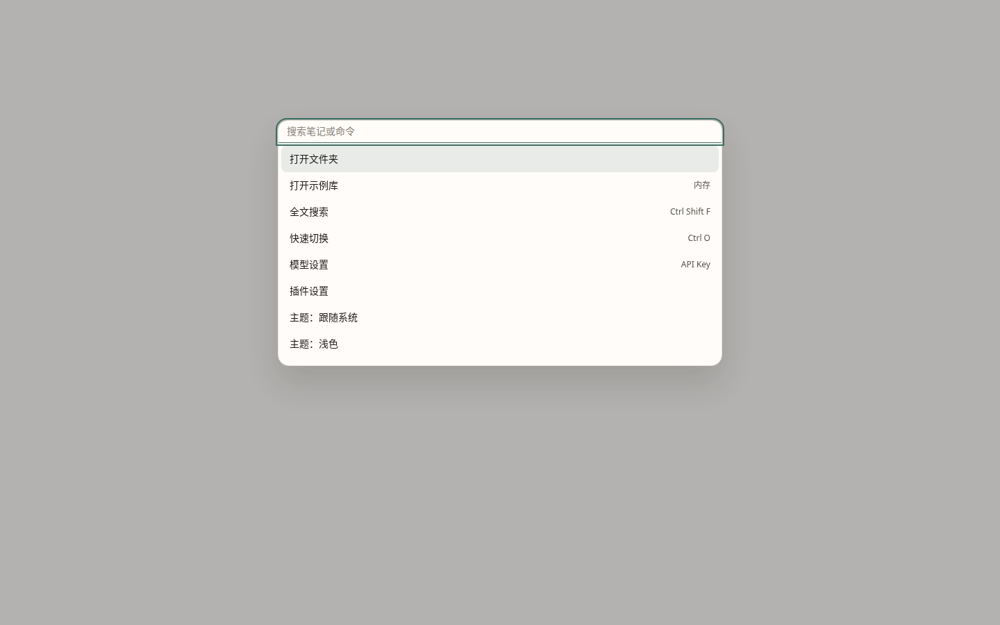

# ai-notes

[中文](README.zh-CN.md)

ai-notes is a local-first notebook: the notes are Markdown files you own, with built-in AI (RAG answers that cite those notes, plus SM-2 memory cards), a sandboxed plugin system, and fully offline [Ollama](https://ollama.com).

[](https://github.com/zy1252732214/ai-notes/actions/workflows/ci.yml)
[](LICENSE)



[Demo: open the sample vault, add a wikilink, search, and ask with citations](docs/assets/demo.mp4)

The interface is in Chinese today. Screenshots are the in-memory sample vault, opened from the browser preview.

## Features

- **Your folder is the database.** Each note is a `.md` file. The SQLite index under `<vault>/.ainotes/` can be deleted and rebuilt.
- **Editor.** [CodeMirror 6](https://codemirror.net/) edits the Markdown source. `Ctrl/Cmd+S` saves immediately, and the note also saves about 800ms after you stop typing.
- **Links.** `[[wikilinks]]` open with `Ctrl/Cmd+click`. The Links panel lists backlinks, plus Markdown links, embeds, and block references found in the index.
- **Find.** Full-text search with snippets (`Ctrl/Cmd+Shift+F`), a fuzzy quick switcher (`Ctrl/Cmd+O`), and a command palette (`Ctrl/Cmd+K`).
- **Hybrid retrieval.** Keyword search is always available. Set an embedding model and desktop search also uses [sqlite-vec](https://github.com/asg017/sqlite-vec). Leave the embedding model empty and search stays keyword-only.
- **Answers with citations.** Ask against the open note and the retrieved chunks. The reply streams. `[[paths]]` in the answer are clickable. If the model cites nothing, the notes that were retrieved are still listed when the reply finishes.
- **Your model.** An OpenAI-compatible endpoint (OpenAI, DeepSeek, OpenRouter, LM Studio, Ollama's `/v1`, …) or Ollama's native API at `http://127.0.0.1:11434`. No account with us.
- **Keys stay on the machine.** The desktop app stores API keys in the system keychain (macOS Keychain, Windows Credential Manager, Linux Secret Service). The browser preview has no keychain, so the key stays in `localStorage`. Neither is written into the vault.
- **Memory cards are Markdown.** Files in `记忆/` use [SM-2](docs/cards.md). Handwritten `question::answer` lines, `{{cloze}}`, and `card` fences are collected from your notes. Generating cards from a note is optional and uses the model you already configured.
- **Plugins in a sandbox.** Community plugins run in an iframe with no `allow-same-origin`. They declare permissions (`vault:read`, `vault:write`, `ai:invoke`, `network`, `ui:panel`, `clipboard`) and talk to the host over RPC. See [docs/plugins](docs/plugins/README.md).
- **Three desktop builds, plus a browser preview.** Tag `v*` to produce an unsigned macOS dmg, Windows NSIS and MSI installers, and a Linux AppImage and deb.

Not in this version: a graph view, mobile apps, sync, a plugin marketplace, and inline AI edits inside the editor. `apps/web` and `server` are placeholders. The browser preview is the desktop UI running in Vite, not a separate web product.

## How it compares

These are different tools. The table is what each one is built around, not a ranking.

|                 | ai-notes 0.1.0                                                                    | Obsidian                                      | Logseq                                               |
| --------------- | --------------------------------------------------------------------------------- | --------------------------------------------- | ---------------------------------------------------- |
| Notes on disk   | A folder of Markdown                                                              | A folder of Markdown                          | Markdown or Org files, edited as an outliner         |
| App license     | MIT                                                                               | Closed source, free for personal use          | AGPL-3.0                                             |
| Links           | Wikilinks and a backlinks panel. No graph view yet                                | Wikilinks, backlinks, graph                   | Block links and a graph                              |
| Built-in AI     | RAG over the vault, citations required by the prompt, OpenAI-compatible or Ollama | Not in the core app; community plugins add it | Not the core workflow; community plugins add it      |
| Offline model   | Ollama on localhost, no key required                                              | Depends on the plugin                         | Depends on the plugin                                |
| Review          | SM-2 cards stored as Markdown in `记忆/`                                          | Community plugins                             | Block flashcards via properties                      |
| Plugins         | iframe sandbox, permissions in a manifest, API still preview                      | JavaScript plugins with the app's plugin API  | JavaScript plugins                                   |
| Sync            | None. Copy the folder, or use your own git or disk sync                           | Official paid Sync, plus community options    | Official paid Sync, plus files you can sync yourself |
| Mobile          | None                                                                              | iOS and Android                               | iOS and Android                                      |
| Desktop install | Unsigned macOS, Windows, and Linux builds                                         | Signed official builds                        | Official builds                                      |

## Download

Installers are built when a `v*` tag is pushed. The workflow uploads them to a **draft** GitHub Release and does not publish it for you. Builds are unsigned unless you add your own signing secrets.

[github.com/zy1252732214/ai-notes/releases](https://github.com/zy1252732214/ai-notes/releases)

| Runner  | Files                                   |
| ------- | --------------------------------------- |
| macOS   | Universal dmg (Apple silicon and Intel) |
| Windows | NSIS (`.exe`) and MSI                   |
| Linux   | AppImage and deb                        |

The app version in this tree is `0.1.0`, so the matching tag is `v0.1.0`. macOS may refuse an unsigned download until you allow it in System Settings. There is no auto-update yet.

Until a release is published, use the browser preview below. It is the same UI.

## Quick start

You need Node.js **26.13.0** (see [`.nvmrc`](.nvmrc)) and pnpm **12.16.1**.

```bash
git clone https://github.com/zy1252732214/ai-notes.git
cd ai-notes
nvm use
npm install -g pnpm@12.16.1
pnpm install
pnpm --filter @ai-notes/desktop exec vite
```

Open <http://localhost:1420> and choose **打开示例库**. That vault lives in memory. **打开文件夹** writes real files; in a browser that needs the File System Access API (Chromium).

Desktop window (Linux needs WebKitGTK 4.1):

```bash
pnpm --filter @ai-notes/desktop dev
```

| Action                 | Shortcut                    |
| ---------------------- | --------------------------- |
| Save                   | `Ctrl/Cmd+S`                |
| Command palette        | `Ctrl/Cmd+K`                |
| Search the vault       | `Ctrl/Cmd+Shift+F`          |
| Quick switcher         | `Ctrl/Cmd+O`                |
| Toggle the file tree   | `Ctrl/Cmd+\`                |
| Toggle the right panel | `Ctrl/Cmd+J`                |
| Open a wikilink        | `Ctrl/Cmd+click`            |
| Review cards           | Space to flip, then `1`–`4` |

### Connect Ollama

Ollama is enough for answers. Cards you write by hand, search, and the editor do not need a model.

```bash
# Browser preview. The desktop webview origin is http://tauri.localhost;
# add it too if a packaged build cannot reach Ollama.
OLLAMA_ORIGINS=http://localhost:1420,http://tauri.localhost ollama serve
ollama pull llama3.2
```

In the app, open **模型设置** and set:

| Field    | Value                                                                                |
| -------- | ------------------------------------------------------------------------------------ |
| 提供方   | Ollama                                                                               |
| 接口地址 | `http://127.0.0.1:11434`                                                             |
| 模型     | `llama3.2` (or whatever you pulled)                                                  |
| API Key  | leave empty                                                                          |
| 嵌入模型 | empty for keyword search, or `nomic-embed-text` after `ollama pull nomic-embed-text` |

Save, open a note, and ask in the **问答** panel. If the browser blocks the request, the console shows the `Origin` Ollama refused. Add that origin to `OLLAMA_ORIGINS`. A `*` value works on your own machine and should not be left on a shared one.

An OpenAI-compatible API uses the same dialog: provider **OpenAI 兼容**, base URL ending in `/v1` (the default is `https://api.openai.com/v1`), a model name, and an API key. On the desktop that key goes to the system keychain.

Card syntax and the review keys are documented in [docs/cards.md](docs/cards.md).







## Build from source

```bash
pnpm install
pnpm turbo run lint typecheck test build
pnpm format:check
```

`pnpm build` compiles TypeScript and the desktop frontend. It does not run `tauri build`. Installers are produced by [`.github/workflows/release.yml`](.github/workflows/release.yml). Day-to-day commands, the repo map, and the release steps are in [CONTRIBUTING.md](CONTRIBUTING.md).

## Plugins

The API is **preview v1**. It can still change before 1.0, and plugins have to move with the host.

- Guide, manifest, API reference: [docs/plugins](docs/plugins/README.md)
- Copyable template: [`templates/plugin-starter`](templates/plugin-starter)
- Examples with tests: [`plugins/word-count`](plugins/word-count), [`plugins/daily-notes`](plugins/daily-notes)
- `hello-notes` is copied into a vault's `.ainotes/plugins/` the first time you open it

```bash
node scripts/create-plugin.mjs my-notes "My Notes"
```

## Roadmap

| Now, in 0.1.0                              | Next                                                 | Later                                                                |
| ------------------------------------------ | ---------------------------------------------------- | -------------------------------------------------------------------- |
| Editor, wikilinks, search, command palette | Graph view                                           | Optional end-to-end encrypted sync (`server/` is only a placeholder) |
| Cited RAG, Ollama, keychain                | AI actions on the current selection                  | A plugin directory with review                                       |
| SM-2 cards as Markdown                     | Signed builds and an updater                         | Mobile, and a real web app (`apps/web` is a placeholder)             |
| Sandboxed plugins, three example plugins   | Freeze the plugin API once more plugins have shipped |                                                                      |

## Contributing

Issues and pull requests are welcome. Read [CONTRIBUTING.md](CONTRIBUTING.md) before a large change. Plugin ideas have their own [issue form](.github/ISSUE_TEMPLATE/plugin.yml). Security reports go through [SECURITY.md](SECURITY.md), not a public issue.

Please also read the [code of conduct](CODE_OF_CONDUCT.md).

## License

[MIT](LICENSE) © zy1252732214 and ai-notes contributors.
