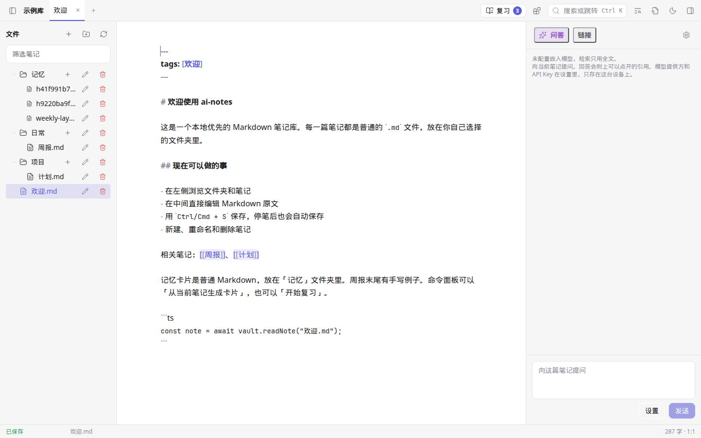
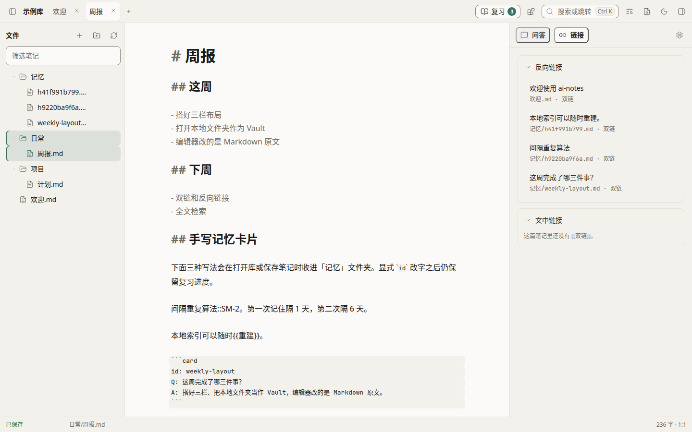
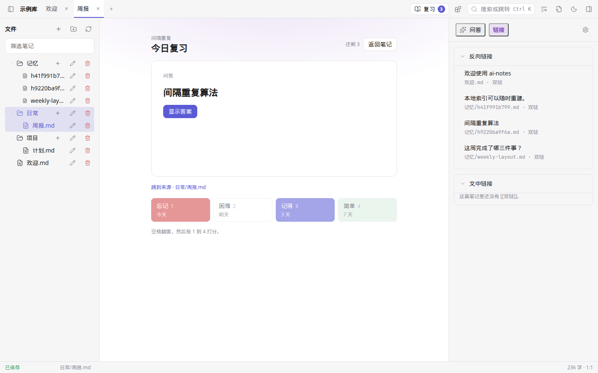
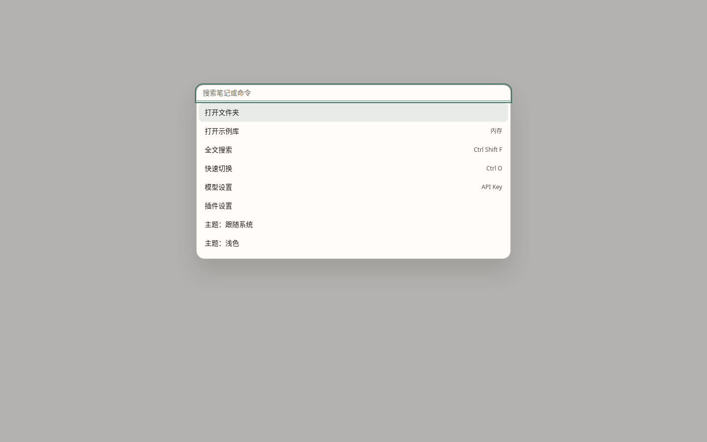

# ai-notes

[English](README.md)

ai-notes 是本地优先的笔记应用：数据是你自己的 Markdown，自带 AI（带引用的 RAG 问答，以及 SM-2 记忆卡片），插件跑在安全沙箱里，也可以完全离线使用 [Ollama](https://ollama.com)。

[](https://github.com/zy1252732214/ai-notes/actions/workflows/ci.yml)
[](LICENSE)



界面目前是中文。截图来自浏览器预览里的内存示例库。

## 特性

- **文件夹就是数据库。** 一篇笔记一个 `.md` 文件。`<vault>/.ainotes/` 下的 SQLite 索引可以删掉重建。
- **编辑器。** [CodeMirror 6](https://codemirror.net/) 改的是 Markdown 原文。`Ctrl/Cmd+S` 立刻保存，停笔大约 800ms 后也会自动保存。
- **链接。** `[[双链]]` 按住 `Ctrl/Cmd` 再点击才会跳转。右侧「链接」列出反向链接，以及索引里识别出的 Markdown 链接、嵌入和块引用。
- **查找。** 带片段的全文搜索（`Ctrl/Cmd+Shift+F`）、按文件名模糊匹配的快速切换（`Ctrl/Cmd+O`）、命令面板（`Ctrl/Cmd+K`）。
- **混合检索。** 关键词搜索一直都在。填了嵌入模型之后，桌面端还会用 [sqlite-vec](https://github.com/asg017/sqlite-vec)。嵌入模型留空就只有全文。
- **带引用的回答。** 问答带上当前笔记和检索到的片段，回答是流式的。回答里的 `[[路径]]` 可以点开。模型一个链接都没写时，生成结束后仍会列出检索到的笔记。
- **模型是你自己的。** OpenAI 兼容接口（OpenAI、DeepSeek、OpenRouter、LM Studio、Ollama 的 `/v1` 等），或本机 Ollama 的原生 API（`http://127.0.0.1:11434`）。没有我们的账号。
- **密钥留在这台机器上。** 桌面端把 API Key 放进系统钥匙串（macOS 钥匙串、Windows 凭据管理器、Linux Secret Service）。浏览器预览没有钥匙串，密钥留在 `localStorage`。两种都不会写进笔记库。
- **记忆卡片就是 Markdown。** `记忆/` 里的文件用 [SM-2](docs/cards.md) 复习。笔记里的 `问题::答案`、`{{挖空}}` 和 `card` 代码块会被收成卡片。从笔记生成卡片是可选的，走你已经配好的模型。
- **插件在沙箱里。** 社区插件跑在不带 `allow-same-origin` 的 iframe 里，在清单里声明权限（`vault:read`、`vault:write`、`ai:invoke`、`network`、`ui:panel`、`clipboard`），通过 RPC 和宿主说话。见 [docs/plugins](docs/plugins/README.md)。
- **三个桌面平台，外加浏览器预览。** 打 `v*` tag 会产出未签名的 macOS dmg、Windows NSIS 和 MSI、Linux AppImage 和 deb。

这一版还没有：图谱、移动端、同步、插件市场、编辑器里的划词改写。`apps/web` 和 `server` 是占位。浏览器预览是桌面界面跑在 Vite 里，不是另一个 Web 产品。

## 和别的工具怎么不同

这三样是不同的工具。表里写的是各自围绕什么来做，不是排行。

|            | ai-notes 0.1.0                                       | Obsidian                              | Logseq                                |
| ---------- | ---------------------------------------------------- | ------------------------------------- | ------------------------------------- |
| 笔记放在哪 | 一个 Markdown 文件夹                                 | 一个 Markdown 文件夹                  | Markdown 或 Org，以大纲方式编辑       |
| 应用许可证 | MIT                                                  | 闭源，个人使用免费                    | AGPL-3.0                              |
| 链接       | 双链和反链面板。还没有图谱                           | 双链、反链、图谱                      | 块链接和图谱                          |
| 自带 AI    | 对整个库做 RAG，提示词要求引用；OpenAI 兼容或 Ollama | 不在核心里，由社区插件提供            | 不是核心流程，由社区插件提供          |
| 离线模型   | 本机 Ollama，通常不需要密钥                          | 取决于插件                            | 取决于插件                            |
| 复习       | SM-2 卡片本身就是 `记忆/` 里的 Markdown              | 社区插件                              | 用属性给块做抽认卡                    |
| 插件       | iframe 沙箱，清单声明权限，API 仍是 preview          | JavaScript 插件，走应用自己的插件 API | JavaScript 插件                       |
| 同步       | 没有。复制文件夹，或用你自己的 git / 网盘            | 官方付费 Sync，也有社区方案           | 官方付费 Sync，文件本身也可以自己同步 |
| 移动端     | 没有                                                 | iOS 和 Android                        | iOS 和 Android                        |
| 桌面安装包 | 未签名的 macOS、Windows、Linux                       | 官方签名包                            | 官方安装包                            |

## 下载

推送 `v*` tag 之后，流水线把安装包上传到一个 **draft** GitHub Release，不会自动公开。没有配置你自己的签名密钥时，包是未签名的。

[github.com/zy1252732214/ai-notes/releases](https://github.com/zy1252732214/ai-notes/releases)

| 平台    | 文件                           |
| ------- | ------------------------------ |
| macOS   | 通用 dmg（Apple 芯片和 Intel） |
| Windows | NSIS（`.exe`）和 MSI           |
| Linux   | AppImage 和 deb                |

这个树里的版本号是 `0.1.0`，对应的 tag 是 `v0.1.0`。macOS 可能会拦住未签名的下载，需要在系统设置里允许。还没有自动更新。

Release 还没公开时，用下面的浏览器预览。界面是同一套。

## 快速开始

需要 Node.js **26.13.0**（见 [`.nvmrc`](.nvmrc)）和 pnpm **12.16.1**。

```bash
git clone https://github.com/zy1252732214/ai-notes.git
cd ai-notes
nvm use
npm install -g pnpm@12.16.1
pnpm install
pnpm --filter @ai-notes/desktop exec vite
```

打开 <http://localhost:1420>。第一次进入、还没打开笔记库、也还没保存模型设置时，引导界面会把 **打开示例库** 放在最前面。这个库只在内存里，不注册、不填 API Key 也能试编辑、搜索和问答。**打开本地文件夹** 仍然保留，用来打开真实目录；在浏览器里需要 File System Access API（Chromium）。打开过笔记库，或已经保存过模型设置之后，再次启动会回到原来的选库界面（**打开文件夹** / **打开示例库**），不会把已经打开的库拉回引导。

桌面窗口（Linux 需要 WebKitGTK 4.1）：

```bash
pnpm --filter @ai-notes/desktop dev
```

| 动作               | 快捷键                      |
| ------------------ | --------------------------- |
| 保存               | `Ctrl/Cmd+S`                |
| 命令面板           | `Ctrl/Cmd+K`                |
| 全文搜索           | `Ctrl/Cmd+Shift+F`          |
| 快速切换           | `Ctrl/Cmd+O`                |
| 显示或收起文件树   | `Ctrl/Cmd+\`                |
| 显示或收起右侧面板 | `Ctrl/Cmd+J`                |
| 打开双链           | 按住 `Ctrl/Cmd` 再点击      |
| 复习卡片           | 空格翻面，然后按 `1` 到 `4` |

### 接上 Ollama

回答问题用 Ollama 就够了。手写卡片、搜索和编辑器都不需要模型。

```bash
# 浏览器预览。安装包里的页面来源是 http://tauri.localhost，
# 打包后如果连不上 Ollama，把这个来源也加进去。
OLLAMA_ORIGINS=http://localhost:1420,http://tauri.localhost ollama serve
ollama pull llama3.2
```

如果这次是第一次使用，并且本机 Ollama 已经在 `http://127.0.0.1:11434` 上、能列出本地模型（`GET /api/tags`），引导会替你填好 **模型设置**：提供方 Ollama、上面的地址、空的 API Key，以及一个已经安装的聊天模型。优先选常见的小模型，例如 `llama3.2`、`llama3.1` 或 Qwen，不会把嵌入模型当成聊天模型。装了 `nomic-embed-text` 时，界面会建议用它做嵌入，但这个字段仍留空，搜索继续只用全文，直到你自己打开。引导不会执行 `ollama pull`，也不会联网下载模型。连不上 Ollama 时，示例库和编辑器照常打开，只提示先运行 `ollama serve`；浏览器预览还要设置 `OLLAMA_ORIGINS`。已经保存过的模型设置不会被覆盖，也不会再去探测。

也可以自己打开 **模型设置**：

| 字段     | 值                                                                           |
| -------- | ---------------------------------------------------------------------------- |
| 提供方   | Ollama                                                                       |
| 接口地址 | `http://127.0.0.1:11434`                                                     |
| 模型     | `llama3.2`（或你拉取的其他模型）                                             |
| API Key  | 留空                                                                         |
| 嵌入模型 | 留空则只用全文；或先 `ollama pull nomic-embed-text`，再填 `nomic-embed-text` |

保存，打开一篇笔记，在 **问答** 里提问。如果浏览器拦住了请求，控制台里会有被拒绝的 `Origin`，把它加进 `OLLAMA_ORIGINS`。设成 `*` 只适合你自己的机器，不要留在共享环境里。

OpenAI 兼容接口用同一个对话框：提供方选 **OpenAI 兼容**，地址以 `/v1` 结尾（默认 `https://api.openai.com/v1`），填模型名和 API Key。桌面端会把这把密钥放进系统钥匙串。

卡片写法和复习按键见 [docs/cards.md](docs/cards.md)。







## 从源码构建

```bash
pnpm install
pnpm turbo run lint typecheck test build
pnpm format:check
```

`pnpm build` 编译 TypeScript 和桌面端前端，不会跑 `tauri build`。安装包由 [`.github/workflows/release.yml`](.github/workflows/release.yml) 产出。日常命令、仓库地图和发版步骤在 [CONTRIBUTING.md](CONTRIBUTING.md)。

## 插件

API 是 **preview v1**。1.0 之前形状还可以变，插件要和宿主一起升级。

- 入门、清单和 API 参考：[docs/plugins](docs/plugins/README.md)
- 可复制模板：[`templates/plugin-starter`](templates/plugin-starter)
- 带测试的例子：[`plugins/word-count`](plugins/word-count)、[`plugins/daily-notes`](plugins/daily-notes)
- 第一次打开笔记库时，会把 `hello-notes` 复制进 `.ainotes/plugins/`

```bash
node scripts/create-plugin.mjs my-notes "My Notes"
```

## 路线图

| 现在的 0.1.0                 | 接下来                           | 以后                                               |
| ---------------------------- | -------------------------------- | -------------------------------------------------- |
| 编辑器、双链、搜索、命令面板 | 图谱                             | 可选的端到端加密同步（`server/` 还只是占位）       |
| 带引用的 RAG、Ollama、钥匙串 | 对选中文本做 AI 操作             | 带审核的插件目录                                   |
| SM-2 卡片就是 Markdown       | 签名安装包和自动更新             | 移动端，以及真正的 Web 应用（`apps/web` 还是占位） |
| 沙箱插件和三个示例           | 有更多插件接上之后再冻结插件 API |                                                    |

## 参与

欢迎提 Issue 和 Pull Request。改动比较大之前先看 [CONTRIBUTING.md](CONTRIBUTING.md)。插件想法用专门的 [Issue 表单](.github/ISSUE_TEMPLATE/plugin.yml)。安全问题按 [SECURITY.md](SECURITY.md) 私下报告，不要开公开 Issue。

也请阅读[行为准则](CODE_OF_CONDUCT.md)。

## 许可证

[MIT](LICENSE) © zy1252732214 与 ai-notes contributors。
